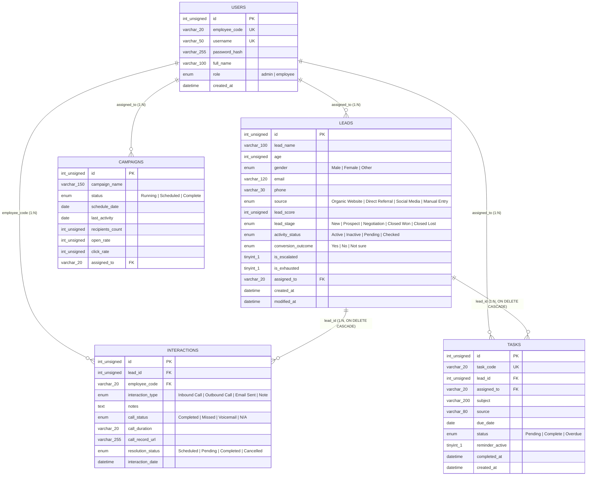

# AutoLead - Dual-Panel Lead Monitoring and Management Web Application

AutoLead is a full-stack, dual-panel Customer Relationship Management (CRM) and lead monitoring web application engineered to run on an Apache, MySQL, and PHP (XAMPP) stack. The platform provides a unified operational loop between an executive **Admin Panel** (macro-level pipeline oversight, lead ingestion, task intervention, credential provisioning, and business intelligence) and a personalized **Employee Panel** (daily workspace queues, 5-tab Smart Views, pipeline stage progression, interaction logging, and email campaign telemetry).

Built strictly with framework-free Vanilla HTML5, CSS3, ES6+ JavaScript, raw PHP (PDO), and MySQL, AutoLead enforces a high-contrast, zero-CLS user interface using inline vector SVG iconography, a persistent Dark/Light theme engine, and transactional database synchronization.

---

## Table of Contents

1. [System Highlights and Architectural Standards](#1-system-highlights-and-architectural-standards)
2. [Core Features Breakdown](#2-core-features-breakdown)
   - [2.1 Admin Panel Core Features](#21-admin-panel-core-features)
   - [2.2 Employee Panel Core Features](#22-employee-panel-core-features)
   - [2.3 Real-Time Admin and Employee Synchronization Workflows](#23-real-time-admin-and-employee-synchronization-workflows)
3. [Technology Stack and Engineering Implementation](#3-technology-stack-and-engineering-implementation)
4. [Complete Directory Structure and File Purpose](#4-complete-directory-structure-and-file-purpose)
5. [Database Schema and Data Dictionary](#5-database-schema-and-data-dictionary)
   - [5.1 Entity-Relationship Diagram (Mermaid)](#51-entity-relationship-diagram-mermaid)
   - [5.2 Table Purpose and Column Specifications](#52-table-purpose-and-column-specifications)
6. [Local XAMPP Installation and Setup Guide](#6-local-xampp-installation-and-setup-guide)
7. [Security Architecture](#7-security-architecture)
8. [Future Scope and Scalability Roadmap](#8-future-scope-and-scalability-roadmap)

---

## 1. System Highlights and Architectural Standards

* **Framework-Free Native Performance**: Engineered without Bootstrap, Tailwind, jQuery, or external UI frameworks. All layouts use native CSS Grid (`minmax(0, 1fr)`), Flexbox, and scoped cascade stylesheets to achieve zero Cumulative Layout Shift (CLS).
* **Strict Vector SVG UI Standard**: All visual indicators, navigation links, status badges, and action triggers use scalable inline vector SVG icons (`stroke="currentColor"`) and clean typography with zero emojis across the codebase or database.
* **Zero-FOUC Persistent Theme Engine**: An Immediately Invoked Function Expression (IIFE) in `js/main.js` reads `localStorage.getItem('autolead-theme')` prior to DOM paint to eliminate Flash of Unstyled Content (FOUC). A `MutationObserver` watches `document.documentElement` for `data-theme` changes and dynamically repaints Chart.js gridlines, axis ticks, and tooltips in real time.
* **ACID-Compliant PDO Backend**: Complex multi-table operations (such as lead ingestion, priority escalation, and lead exhaustion) execute inside atomic MySQL PDO transactions (`beginTransaction()`, `commit()`, `rollBack()`) with native prepared statements.
* **Mobile-Hardened Responsive Design**: Multi-column tables are enclosed in `.table-responsive` scroll containers, and navigation menus collapse into a slide-down mobile accordion drawer under `@media (max-width: 900px)`.

---

## 2. Core Features Breakdown

### 2.1 Admin Panel Core Features

The Admin Panel serves as the central command authority for pipeline distribution, employee auditing, deadline enforcement, and executive analytics:

1. **Central Command Dashboard (`admin/dashboard.html`)**:
   * **Executive KPI Strip**: Real-time counters for *Total Active Pipeline*, *Unassigned / New Stage Leads*, *Closed Won Conversions*, and *System Overdue Tasks*.
   * **7-Day Rolling Lead Growth Chart**: A responsive Chart.js line graph tracking daily lead ingestion velocity across a 7-day rolling window (Mon-Sun).
   * **Leads Funnel Overview Table**: Displays prospect names, acquisition sources, assigned employee codes, and current pipeline stages.
   * **Filterable New Leads Triage**: Time-scoped filtering (*Today*, *This Week*, *This Month*, *All Records*) paired with a **View Profile** button that opens a scroll-locked demographic snapshot modal populated via `data-*` attributes.
   * **Admin-Only Account Provisioning Modal**: A secure credential generator allowing admins to provision new `ADMINxx` or `EMPxxx` accounts with server-side Argon2id/Bcrypt password hashing and an active system accounts directory.

2. **Employee Pipeline Monitoring and Auditing (`admin/employee-monitoring.html`)**:
   * **Employee Code Filter Bar**: Dynamically filters the pipeline by specific employee codes (`EMP001`, `EMP002`, `EMP003`, etc.) or displays a global view (`ALL`), paired with instant client-side search filtering.
   * **Activity Status Override Dropdowns**: Allows admins to update a prospect's administrative status (`Active`, `Inactive`, `Pending`, `Checked`) directly from the table.
   * **Hard-Action Admin Overrides**:
     * **Send (Priority Escalation)**: Flags the lead as `is_escalated = 1`, sets status to `Active`, creates a high-priority task (`[ADMIN PRIORITY DISPATCH]`) due today, and pushes the lead to the top of the assigned employee's workspace funnel.
     * **Delete (Cascade Purge)**: Permanently deletes the lead record and leverages MySQL `ON DELETE CASCADE` constraints to automatically clean up all associated tasks and interaction logs.

3. **Granular Prospect Preview and Audio Audit Trail (`admin/lead-preview.html`)**:
   * **Demographic Snapshot Card**: Displays full prospect metadata (Name, Age, Gender, Email, Mobile No., Lead Score badge, Lead Owner, and Acquisition Source) with a dropdown switcher to jump between leads.
   * **Quick Interaction and Task Logger**: Allows admins to log manual Inbound Calls, Outbound Calls (with `MM:SS` duration), Emails Sent, Audit Notes, or assign follow-up Tasks directly to the lead owner.
   * **Chronological Interaction Audit Trail**: A timestamped table displaying every historical touchpoint, mail status, inbound/outbound call duration, and contextual note.
   * **Custom Audio Player Modal with CSS Waveform Visualizer**: Clicking **Listen** on any voice call row opens a scroll-locked audio player featuring a 20-bar staggered CSS keyframe waveform animation (`@keyframes waveBounce`), progress bar scrubber, and timer.

4. **System-Wide Task and Overdue Management (`admin/tasks.html`)**:
   * **Global Deliverable Board**: Lists all tasks across the organization with task codes (`TSK-101`), subjects, associated leads, due dates, sources, and reminder states.
   * **Overdue Escalation Filter**: One-click toggle between *All Tasks* and *Over due task Only*. Past-due rows are automatically highlighted in danger red (`.row-overdue`).
   * **Status Intervention Dropdowns**: Enables admins to mark tasks as `Pending`, `Complete`, or `Overdue` on behalf of any employee.

5. **Quick View Business Intelligence (`admin/analytics.html`)**:
   * **Top-Level BI KPI Cards**: Displays *Total Leads*, *Total Conversions*, and calculated *Conversion Rate %*.
   * **Lead Conversional Trajectory (`Oct - Jun`)**: A wide-format dual-series line chart comparing total lead ingestion against Closed Won conversions over a 9-month longitudinal period.
   * **Outcome Distribution Doughnut Chart**: Visualizes pipeline outcomes (*Yes / Converted*, *No / Lost*, *Not sure / Pending*) paired with a custom-rendered HTML legend displaying exact counts and percentage shares.

6. **Validated Lead Ingestion (`admin/add-lead.html`)**:
   * **Prospect Intake Form**: Captures Lead Full Name, Email, Phone Number, Age (`18-100`), Gender, Acquisition Source (*Organic Website*, *Direct Referral*, *Social Media*, *Manual Entry*), Initial Lead Score (`0-100`), and mandatory assignment to an Employee Code.

---

### 2.2 Employee Panel Core Features

The Employee Panel is a focused execution workspace scoped strictly to the authenticated employee's `employee_code`:

1. **Personalized "My Workspace" Hub (`employee/dashboard.html`)**:
   * **Prominent "COMPLETE TASK" (Lead Exhaustion) Trigger**: A primary action banner allowing employees to select an active lead and execute the exhaustion workflow once all nurturing deliverables are finalized.
   * **4-Week Personal Lead Growth Chart**: A Chart.js line graph displaying the employee's personal lead assignment trajectory across Weeks 1 through 4.
   * **4 Segmented Action Queues**:
     * *My Lead Funnel*: Prioritized list of active, non-exhausted leads with escalated priority badges.
     * *My New Leads*: Freshly ingested leads awaiting initial outreach.
     * *Recently Assigned Leads*: Chronological feed of the latest assignments from the Admin.
     * *Overdue Tasks*: Past-due deliverables highlighted in red for immediate resolution.

2. **Email Outreach Campaigns Monitor (`employee/campaigns.html`)**:
   * **Status Filtering and Search**: Filters outreach sequences by *All*, *Running*, *Scheduled*, or *Complete*.
   * **Dual Animated Telemetry Bars**: Renders animated CSS width transitions and parallel `setInterval` percentage counters tracking *Open Rate %* and *Click Rate %* alongside recipient counts.

3. **Swipeable 5-Tab Smart Views (`employee/smart-views.html`)**:
   * **Single-Page Tabbed Interface**: Switches cleanly via vanilla JavaScript across five operational categories without page reloads:
     1. *New lead*: Displays Name, Email, Number, Calling Feedback Notes, Source, Score badge, Created On, and Modified On.
     2. *Prospect*: Displays qualified leads in `Prospect` or `Negotiation` stages sorted by Lead Score.
     3. *Incoming Calls*: Displays inbound call logs with start time, call status, duration, and an inline **Play** trigger for the audio modal.
     4. *Outgoing Calls*: Displays outbound call logs with duration and inline audio playback.
     5. *Followup*: Lists assigned tasks with due dates and interactive **Reminder: On / Off** toggle buttons.

4. **Manage Lead Pipeline Progression (`employee/manage-lead.html`)**:
   * **Interactive Stage Progression Table**: Displays Lead Name, color-coded Lead Score badge (`High >= 75`, `Medium 50-74`, `Low < 50`), color-coded Lead Stage dropdown (`New`, `Prospect`, `Negotiation`, `Closed Won`, `Closed Lost`), Owner, Modified On, and Created On.
   * **Real-Time Timestamp Feedback**: Changing a lead's stage immediately updates the database and flashes `"Just now"` in the *Modified On* column.

5. **Manage Interaction Activity Log (`employee/manage-activity.html`)**:
   * **Quick-Add Activity Bar**: A top horizontal form allowing employees to select an assigned lead, choose a channel (*Outbound Call*, *Inbound Call*, *Email Sent*, *Contextual Note*), enter feedback notes, and set an initial resolution status.
   * **Resolution Status Auditing**: Each interaction row includes a color-coded status dropdown (`Scheduled`, `Pending`, `Completed`, `Cancelled`). Marking an item `Completed` refreshes its *Activity Date* to `"Just now"`.

6. **Manage Assigned Tasks and Deadlines (`employee/manage-task.html`)**:
   * **Deliverable Execution Table**: Displays Task ID (`TSK-xxx`), Subject, Associated Lead, Status dropdown (`Pending`, `Complete`, `Overdue`), Due Date, Reminder badge, and Owner with real-time ID/Subject search.
   * **Automated Overdue and Reminder Clean-Up**: Selecting `Complete` on any task immediately strips the `.row-overdue` danger highlight and flips the Reminder badge to `Off`.

---

### 2.3 Real-Time Admin and Employee Synchronization Workflows

Both panels communicate with the shared `autolead_db` database through `api/admin_api.php` and `api/employee_api.php`. Every mutation on one portal is immediately reflected on the other:

| Workflow Name | Triggering Role & View | Backend API & Database Transaction | Immediate Cross-Panel Synchronization Result |
| :--- | :--- | :--- | :--- |
| **1. Lead Ingestion to Employee Queue** | **Admin** submits `admin/add-lead.html` assigned to `EMP001` | `admin_api.php?action=add_lead` inserts row into `leads`, auto-generates task `TSK-xxx` in `tasks`, and logs initial note in `interactions`. | **Employee (`EMP001`)** immediately sees the prospect in *My New Leads*, *Recently Assigned Leads*, *Smart Views (New lead)*, and the task in *Manage Task*. |
| **2. Stage Progression to Admin BI** | **Employee** updates stage dropdown in `employee/manage-lead.html` | `employee_api.php?action=update_lead_stage` updates `leads.lead_stage`, syncs `conversion_outcome` (`Yes`/`No`), sets `modified_at = NOW()`, and logs an audit note. | **Admin** sees the updated stage and `"Just now"` timestamp in `employee-monitoring.html`, the audit note in `lead-preview.html`, and updated conversion KPIs/charts in `analytics.html`. |
| **3. Call/Activity Logging to Admin Audit** | **Employee** logs call/note or marks activity `Completed` in `employee/manage-activity.html` | `employee_api.php?action=add_activity` / `update_activity_resolution` inserts/updates `interactions` and touches `leads.modified_at = NOW()`. | **Admin** sees incremented call/log counters and latest note in `employee-monitoring.html`, plus the full playable call record in `lead-preview.html`. |
| **4. Task Completion & Overdue Clean-Up** | **Employee** sets task status to `Complete` in `employee/manage-task.html` | `employee_api.php?action=update_task` sets `status = 'Complete'`, `reminder_active = 0`, and `completed_at = NOW()`. | **Employee** UI strips `.row-overdue` red styling and flips Reminder to `Off`. **Admin** `tasks.html` removes the task from the overdue filter and shows `Complete`. |
| **5. "COMPLETE TASK" Lead Exhaustion** | **Employee** clicks `COMPLETE TASK` button on `employee/dashboard.html` | `employee_api.php?action=complete_task_exhaustion` sets `leads.is_exhausted = 1`, `activity_status = 'Checked'`, `conversion_outcome = 'Yes'`, and completes all child tasks. | Lead is cleared from the **Employee's** active daily queues (`WHERE is_exhausted = 0`), while **Admin** analytics and monitoring tables reflect the finalized conversion. |
| **6. Admin Priority Escalation & Delete** | **Admin** clicks `Send` or `Delete` in `admin/employee-monitoring.html` | `escalate_lead` sets `is_escalated = 1` and dispatches a priority task due today. `delete_lead` deletes the parent lead (`ON DELETE CASCADE`). | **Employee** sees escalated leads jump to the top of `dashboard.html` with a `Priority` badge, or sees deleted leads and child tasks purged across all views. |

---

## 3. Technology Stack and Engineering Implementation

| Layer | Technology | Implementation Details in AutoLead |
| :--- | :--- | :--- |
| **Markup & Icons** | **HTML5 & Inline Vector SVG** | Semantic HTML5 views across 13 pages. Uses inline `<svg viewBox="0 0 24 24" stroke="currentColor">` icons and `data-*` attributes for modal hydration. |
| **Styling & Layout** | **Vanilla CSS3 (12 Modular Files)** | Custom properties (`:root` and `[data-theme="dark"]`), CSS Grid (`minmax(0, 1fr)`), Flexbox, keyframe animations (`@keyframes waveBounce`, `@keyframes autolead-spin`), and dark-mode protected native `<select>` controls. |
| **Client Logic** | **Vanilla ES6+ JavaScript (13 Modules)** | Modular controllers using `async/await` `fetch()` wrappers, DOM event delegation, `localStorage` theme persistence, `MutationObserver` chart repainting, and client-side search filtering. |
| **Data Visualization** | **Chart.js (v4.4.1 via CDN)** | Renders the Admin 7-day rolling growth line chart, Admin Oct-Jun dual conversion line chart, Admin outcome doughnut chart, and Employee 4-week personal growth line chart. |
| **Backend API** | **Raw PHP 8+ (REST-like JSON)** | Stateless JSON endpoints (`auth.php`, `admin_api.php`, `employee_api.php`) enforcing strict type declarations (`declare(strict_types=1);`), HTTP status codes, and input sanitization. |
| **Database Access** | **PHP Data Objects (PDO)** | Singleton connection class (`config/db.php`) configured with `PDO::ERRMODE_EXCEPTION`, `PDO::FETCH_ASSOC`, `ATTR_EMULATE_PREPARES => false`, and `utf8mb4_unicode_ci`. |
| **Database Engine** | **MySQL / MariaDB (InnoDB)** | Normalized 5-table relational schema (`autolead_db`) using foreign key constraints, cascading deletes, B-Tree indexes, and relative SQL date functions. |
| **Local Server** | **XAMPP (Apache + MySQL)** | Hosted locally under `htdocs/autolead/` (or `D:/xampp/htdocs/Autolead/`) over standard Apache HTTP and MySQL port `3306`. |

---

## 4. Complete Directory Structure and File Purpose

```text
autolead/ (XAMPP Root Directory)
|
|-- index.html                      # Centralized authentication interface with Admin/Employee role toggle
|-- README.md                       # Complete project documentation and architecture guide
|
|-- [asset]                         # Brand visual assets
|   |-- icon.png                    # Global website favicon linked across all 13 HTML pages
|   |-- logo.png                    # Primary brand logo rendered in authentication and top navbars
|
|-- [config]                        # Backend configuration, database singleton, and RBAC security
|   |-- db.php                      # Singleton MySQL PDO connection (utf8mb4, native prepared statements)
|   |-- session.php                 # Session lifecycle, JSON response helpers, and requireRole() middleware
|   |-- create_user_cli.php         # Optional terminal-only CLI utility for provisioning credentials
|
|-- [database]                      # Database schema and initial seed data
|   |-- autolead.sql                # Normalized 5-table SQL dump with foreign keys and rich seed records
|
|-- [api]                           # REST-like PHP JSON endpoints
|   |-- auth.php                    # Handles POST login, rate-limiting lockout, session checks, and logout
|   |-- admin_api.php               # Handles Admin dashboard, monitoring overrides, lead preview, tasks, BI, add lead, and user provisioning
|   |-- employee_api.php            # Handles Employee workspace, COMPLETE TASK exhaustion, Smart Views, stage/activity/task updates, and campaigns
|
|-- [admin]                         # Admin Panel HTML views (6 Pages)
|   |-- dashboard.html              # Central hub: KPI strip, 7-day chart, funnel table, triage, profile modal, and account provisioning modal
|   |-- employee-monitoring.html    # Employee code filter, pipeline table, activity status select, and Send/Delete override buttons
|   |-- lead-preview.html           # Prospect demographic card, quick interaction logger, audit trail table, and Audio Player modal
|   |-- tasks.html                  # System-wide task table, overdue filter toggle, and status intervention dropdowns
|   |-- analytics.html              # Quick View BI: KPI cards, Oct-Jun conversion line graph, and outcome doughnut chart with custom legend
|   |-- add-lead.html               # Validated lead intake form with source selection and direct Employee Code assignment
|
|-- [employee]                      # Employee Panel HTML views (6 Pages)
|   |-- dashboard.html              # Personalized "My Workspace": COMPLETE TASK button, 4-week growth chart, and 4 action queues
|   |-- campaigns.html              # Email outreach monitor with status filter and dual animated Open/Click progress bars
|   |-- smart-views.html            # Swipeable 5-tab workspace: New Lead, Prospect, Incoming Calls, Outgoing Calls, and Followup
|   |-- manage-lead.html            # Pipeline progression table with score badges, stage dropdowns, and "Just now" timestamping
|   |-- manage-activity.html        # Quick-add activity bar and interaction resolution audit table
|   |-- manage-task.html            # Deliverable execution table with search, overdue red flags, and automated reminder clean-up
|
|-- [css]                           # Cascade-driven modular stylesheets (12 CSS Files)
|   |-- style.css                   # Global root tokens, dark/light themes, navbar, responsive grids, modals, toasts, and mobile drawer rules
|   |-- auth.css                    # Scoped card layout, role toggle switcher, and quick-fill chip styles for index.html
|   |-- [admin]
|   |   |-- dashboard.css           # Styles for admin metric cards, upper split grid, profile snapshot, and credential modal
|   |   |-- employee-monitoring.css # Styles for employee filter bar, activity selects, and Send/Delete override buttons
|   |   |-- lead-preview.css        # Styles for demographic grid, quick logger, and 20-bar CSS keyframe audio waveform visualizer
|   |   |-- tasks.css               # Styles for global task filter pills, task code badges, and status selects
|   |   |-- analytics.css           # Styles for BI KPI cards, wide chart canvas, and custom HTML doughnut legend
|   |   |-- add-lead.css            # Styles for intake form grid, validation feedback banners, and input error states
|   |-- [employee]
|       |-- dashboard.css           # Styles for My Workspace hero banner, COMPLETE TASK button, and 3-column queue grid
|       |-- campaigns.css           # Styles for dual animated progress bar tracks and outreach telemetry cells
|       |-- smart-views.css         # Styles for swipeable 5-tab navigation bar, tab counters, and inline call player modal
|       |-- manage-tables.css       # Shared styles for Manage Lead, Manage Activity, and Manage Task tables and color-coded selects
|
|-- [js]                            # Modular ES6+ frontend controllers (13 JS Files)
    |-- main.js                     # IIFE zero-FOUC theme loader, MutationObserver, modals, button spinners, toasts, and global logout
    |-- auth.js                     # Login form handler, role switcher, password visibility toggle, and session redirect check
    |-- [admin]
    |   |-- dashboard.js            # Fetches admin dashboard JSON, renders 7-day chart, handles triage filter, profile modal, and user creation
    |   |-- employee-monitoring.js  # Fetches employee pipelines, runs search filter, updates activity status, and executes Send/Delete overrides
    |   |-- lead-preview.js         # Loads single lead audit trail, submits quick interactions/tasks, and controls Audio Player waveform state
    |   |-- tasks.js                # Fetches global/overdue tasks and binds event delegation for Admin status dropdown interventions
    |   |-- analytics.js            # Fetches BI metrics and renders Oct-Jun line graph and outcome doughnut chart with custom legend
    |   |-- add-lead.js             # Validates Add Lead form fields, triggers SVG button loader, and POSTs new lead to admin_api.php
    |-- [employee]
        |-- nav-dropdown.js         # Vanilla JS controller for the Employee "Leads" top dropdown and mobile navigation drawer
        |-- dashboard.js            # Loads employee workspace queues, renders 4-week chart, and triggers COMPLETE TASK exhaustion workflow
        |-- campaigns.js            # Fetches outreach campaigns, animates CSS progress bar widths, and runs setInterval percentage counters
        |-- smart-views.js          # Controls 5-tab switching, search filtering, inline call playback modal, and followup reminder toggles
        |-- manage-tables.js        # Shared controller for Manage Lead, Manage Activity, and Manage Task tables, stage updates, and overdue clean-up
```

---

## 5. Database Schema and Data Dictionary

The MySQL database (`autolead_db`) is normalized to **Third Normal Form (3NF)** across 5 interconnected tables.

### 5.1 Entity-Relationship Diagram (Mermaid)



### 5.2 Table Purpose and Column Specifications

#### 1. `users`
Stores authentication credentials, role classifications, and unique business codes (`employee_code`) for all administrators and employees.
* **Primary Key**: `id` (`INT UNSIGNED AUTO_INCREMENT`)
* **Unique Keys**: `employee_code` (`VARCHAR(20)`, e.g., `ADMIN01`, `EMP001`), `username` (`VARCHAR(50)`)
* **Core Columns**: `password_hash` (`VARCHAR(255)` Argon2id/Bcrypt hash), `full_name` (`VARCHAR(100)`), `role` (`ENUM('admin', 'employee')`), `created_at` (`DATETIME`).

#### 2. `leads`
Central prospect repository storing demographic profiles, qualification scores, pipeline progression stages, escalation flags, and exhaustion states.
* **Primary Key**: `id` (`INT UNSIGNED AUTO_INCREMENT`)
* **Foreign Key**: `assigned_to` references `users(employee_code)` (`ON DELETE RESTRICT ON UPDATE CASCADE`)
* **Core Columns**: `lead_name`, `age`, `gender`, `email`, `phone`, `source`, `lead_score` (`0-100`), `lead_stage` (`New`, `Prospect`, `Negotiation`, `Closed Won`, `Closed Lost`), `activity_status` (`Active`, `Inactive`, `Pending`, `Checked`), `conversion_outcome` (`Yes`, `No`, `Not sure`), `is_escalated` (`BOOLEAN`), `is_exhausted` (`BOOLEAN`), `created_at`, `modified_at`.

#### 3. `interactions`
Chronological audit log recording every inbound call, outbound call, email dispatch, and contextual note linked to a prospect.
* **Primary Key**: `id` (`INT UNSIGNED AUTO_INCREMENT`)
* **Foreign Keys**:
  * `lead_id` references `leads(id)` (`ON DELETE CASCADE ON UPDATE CASCADE`)
  * `employee_code` references `users(employee_code)` (`ON DELETE RESTRICT ON UPDATE CASCADE`)
* **Core Columns**: `interaction_type` (`Inbound Call`, `Outbound Call`, `Email Sent`, `Note`), `notes` (`TEXT`), `call_status` (`Completed`, `Missed`, `Voicemail`, `N/A`), `call_duration` (`VARCHAR(20)`), `call_record_url` (`VARCHAR(255)`), `resolution_status` (`Scheduled`, `Pending`, `Completed`, `Cancelled`), `interaction_date` (`DATETIME`).

#### 4. `tasks`
Deliverable tracking table managing employee follow-up deadlines, overdue status sweeps, and reminder states.
* **Primary Key**: `id` (`INT UNSIGNED AUTO_INCREMENT`)
* **Unique Key**: `task_code` (`VARCHAR(20)`, e.g., `TSK-101`)
* **Foreign Keys**:
  * `lead_id` references `leads(id)` (`ON DELETE CASCADE ON UPDATE CASCADE`)
  * `assigned_to` references `users(employee_code)` (`ON DELETE RESTRICT ON UPDATE CASCADE`)
* **Core Columns**: `subject` (`VARCHAR(200)`), `source` (`VARCHAR(80)`), `due_date` (`DATE`), `status` (`Pending`, `Complete`, `Overdue`), `reminder_active` (`BOOLEAN`), `completed_at` (`DATETIME NULL`), `created_at` (`DATETIME`).

#### 5. `campaigns`
Email marketing telemetry table powering the animated Open Rate % and Click Rate % progress bars on the Employee portal.
* **Primary Key**: `id` (`INT UNSIGNED AUTO_INCREMENT`)
* **Foreign Key**: `assigned_to` references `users(employee_code)` (`ON DELETE RESTRICT ON UPDATE CASCADE`)
* **Core Columns**: `campaign_name` (`VARCHAR(150)`), `status` (`Running`, `Scheduled`, `Complete`), `schedule_date` (`DATE`), `last_activity` (`DATE`), `recipients_count` (`INT UNSIGNED`), `open_rate` (`INT UNSIGNED 0-100`), `click_rate` (`INT UNSIGNED 0-100`).

---

## 6. Local XAMPP Installation and Setup Guide

### Prerequisites
* **XAMPP** (v8.0+ recommended) with **Apache** and **MySQL** modules enabled.
* A modern web browser (Chrome, Edge, Brave, or Firefox).

### Step-by-Step Deployment

1. **Place Project in XAMPP `htdocs`**:
   Copy the `autolead` project folder into your XAMPP web root:
   ```text
   C:\xampp\htdocs\autolead\
   (or D:\xampp\htdocs\Autolead\)
   ```
   Ensure `icon.png` and `logo.png` are present inside the `asset/` directory.

2. **Start XAMPP Services**:
   Open the **XAMPP Control Panel** and click **Start** next to both **Apache** and **MySQL**.

3. **Import the Database Schema and Seed Data**:
   * Open `http://localhost/phpmyadmin` in your browser.
   * Click the **Import** tab at the top.
   * Choose `database/autolead.sql` from the project directory and click **Import / Go**.
   * This automatically creates `autolead_db`, sets up all 5 tables with foreign keys, and populates 1 Admin, 3 Employees, 15 Leads, 20 Interactions, 12 Tasks, and 4 Email Campaigns with dynamic relative dates.

4. **Verify Database Credentials (Optional)**:
   Open `config/db.php` and confirm the MySQL settings match your local XAMPP setup (defaults: `DB_HOST = '127.0.0.1'`, `DB_PORT = '3306'`, `DB_NAME = 'autolead_db'`, `DB_USER = 'root'`, `DB_PASS = ''`).

5. **Launch AutoLead**:
   Navigate to `http://localhost/autolead/index.html` in your browser.

### Default Seed Accounts for Testing

| Portal Role | Employee Code | Username | Default Password | Assigned Seed Data |
| :--- | :--- | :--- | :--- | :--- |
| **Admin Panel** | `ADMIN01` | `admin` | `password123` | Global oversight of all 15 leads, 12 tasks, and BI analytics |
| **Employee Panel** | `EMP001` | `arjun.mehta` | `password123` | 6 Assigned Leads, 10 Interactions, 5 Tasks, 2 Campaigns |
| **Employee Panel** | `EMP002` | `priya.sharma` | `password123` | 5 Assigned Leads, 6 Interactions, 4 Tasks, 1 Campaign |
| **Employee Panel** | `EMP003` | `rohan.verma` | `password123` | 4 Assigned Leads, 4 Interactions, 3 Tasks, 1 Campaign |

---

## 7. Security Architecture

* **Password Cryptography**: Passwords are never stored or compared in plaintext. New accounts provisioned via the Admin Modal or CLI utility are hashed using `PASSWORD_ARGON2ID` (or `PASSWORD_BCRYPT` with `cost => 12`), and existing hashes are transparently upgraded on login via `password_needs_rehash()`.
* **Brute-Force Rate Limiting & Timing-Attack Mitigation**: `api/auth.php` tracks failed login attempts per session and enforces a 15-minute lockout (`HTTP 429 Too Many Requests`) after 5 consecutive failures. Non-existent usernames still execute a dummy `password_verify()` operation to prevent timing-based user enumeration.
* **Role-Based Access Control (RBAC)**: Every request to `api/admin_api.php` executes `requireRole('admin')` and every request to `api/employee_api.php` executes `requireRole('employee')`. Cross-role requests are rejected with `HTTP 403 Forbidden`.
* **SQL Injection & XSS Prevention**: All SQL queries use native PDO prepared statements (`ATTR_EMULATE_PREPARES => false`), and all dynamic DOM rendering passes user strings through `AutoLead.escapeHtml()`.

---

## 8. Future Scope and Scalability Roadmap

1. **Real-Time WebSockets / Server-Sent Events (SSE)**:
   Upgrade the `fetch()` polling loop to a persistent WebSocket or SSE stream so Admin task dispatches and Employee stage progressions push live DOM updates to open browser tabs without requiring view refreshes.
2. **WebRTC VoIP & Cloud Call Recording Integration**:
   Integrate Twilio Voice SDK or Asterisk WebRTC directly into `employee/smart-views.html` and `admin/lead-preview.html` to place live outbound calls from the browser and stream real `.mp3`/`.wav` recordings into the CSS waveform audio player.
3. **Machine Learning Lead Scoring Microservice**:
   Connect AutoLead to a Python FastAPI + XGBoost/Scikit-Learn microservice that dynamically recalculates `leads.lead_score` based on call duration, interaction frequency, email open/click engagement, and conversion history.
4. **Live SMTP & Webhook Email Campaign Engine**:
   Integrate PHPMailer/SendGrid with tracking pixel webhooks so `employee/campaigns.html` can dispatch real bulk HTML newsletters and increment `open_rate` and `click_rate` automatically as recipients interact with emails.
5. **Multi-Tier Role Hierarchy & Audit Exports**:
   Expand RBAC to support Regional Managers and Team Leads overseeing subsets of Employee Codes, paired with one-click CSV and PDF report generation for executive board reviews.
